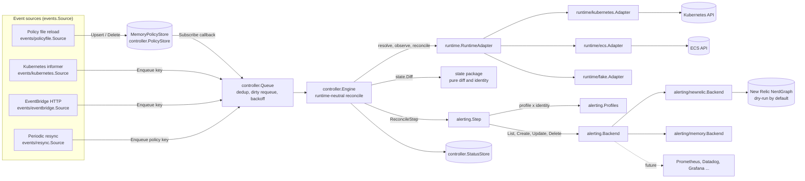
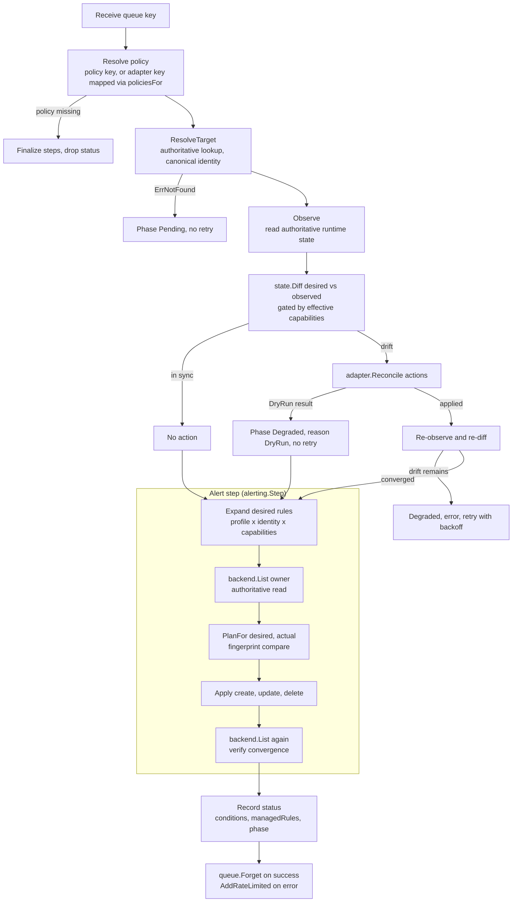
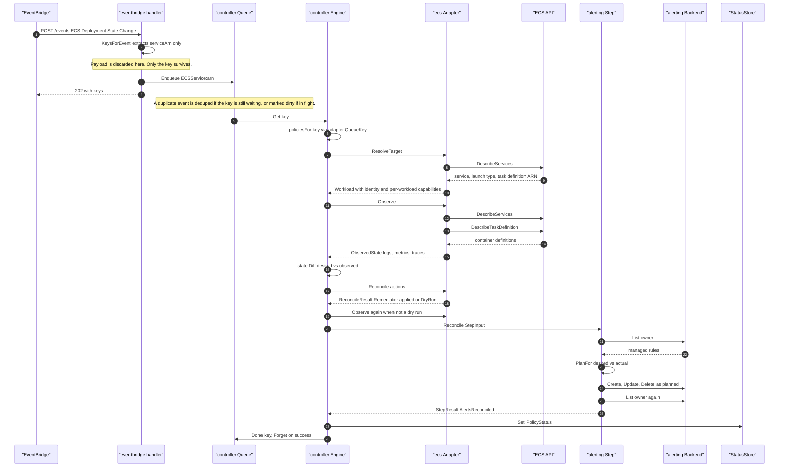
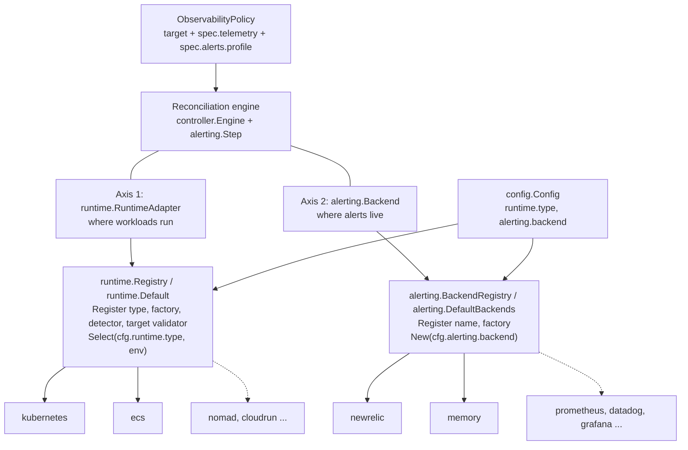
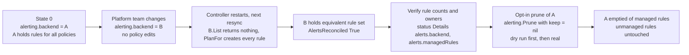

# Architecture

This document describes the Go proof of concept as implemented under `internal/`. Type and function names are real; file paths are relative to the repository root. The requirements it is checked against are in [poc-spec.md](poc-spec.md) (section numbers below refer to it).

## 1. Purpose

The controller's main purpose is **central alert management**.

It is deployed once per runtime environment. It discovers workloads through runtime adapters (Kubernetes and ECS today, more later) and reconciles a default golden-signal alert set (latency, traffic, errors, saturation) for each workload into an alert backend. New Relic is the first backend and runs in dry-run mode by default.

The alert backend is an adapter. If the business moves to another alerting engine, the platform team changes the controller's `alerting.backend` configuration and the controller reconciles the same policies into the new engine. The 500 teams that own workloads do not change their Terraform or their policies. Alert profiles (`standard`, `minimal`) are owned centrally in `internal/alerting/profile.go`.

Two adapter axes make this possible:

- `runtime.RuntimeAdapter`: where workloads run (Kubernetes, ECS, ...).
- `alerting.Backend`: where alerts live (New Relic, in-memory, future engines).

Telemetry configuration reconciliation (logs, metrics, traces) is the original POC scenario from the spec and still runs first for each policy. Alerts are an additional reconcile step layered on top of it.

## 2. Core principle

> Events trigger reconciliation; authoritative APIs determine state. Reconciliation is periodic and idempotent, so correctness does not depend on receiving every event.

> Event sources are not authoritative state. They only trigger reconciliation. The runtime adapter reads authoritative state before deciding what action is required.

The same rule applies to the alert backend. The backend is listed (`alerting.Backend.List`) before every plan and again after applying it. The controller never assumes that an earlier create or update succeeded, and it never keeps a local copy of "what I wrote". Rules are found again through ownership tags persisted in the backend (section 9), so the controller only reads and writes its own alerts.

Consequences:

- An event payload is reduced to a work-queue key and then discarded. `eventbridge.KeysForEvent` extracts only identifiers (service ARN, cluster ARN, task group) and never reads task status, desired counts or deployment state.
- Duplicate, delayed, reordered and lost events are all acceptable. A duplicate finds the state already correct and does nothing. A lost event is corrected by the next periodic resync.
- Event sources contain no business logic. They call `Enqueue` and nothing else.

## 3. Diagrams

### 3.1 Controller architecture



### 3.2 Reconciliation lifecycle



### 3.3 ECS event to alert backend



### 3.4 Two adapter axes and registries



Adapters register themselves from `init()`; the binary enables one by blank-importing its package. Neither registry is known to the engine.

### 3.5 Backend migration



## 4. Components and packages

| Package | Responsibility | Key types and functions |
|---|---|---|
| `internal/policy` | Runtime-neutral policy model, YAML parsing, validation, queue key for policies | `ObservabilityPolicy`, `TargetRef`, `Spec`, `Alerts`, `Parse`, `LoadDir`, `Key`, `ParseKey`, `WithTargetValidator` |
| `internal/state` | Pure desired/observed state, diff, canonical identity, capability vocabulary. Never talks to a runtime | `DesiredState`, `FromPolicy`, `ObservedState`, `WorkloadIdentity`, `Diff`, `DiffResult`, `Action`, `Capability`, `CapabilityChecker`, `ReconcileResult` |
| `internal/runtime` | Runtime adapter contract and registry | `RuntimeAdapter`, `Workload`, `Capabilities`, `Registry`, `Register`, `Select`, `WithTargetValidator`, `EnvSet`, `AnyOf`, `ErrNotFound` |
| `internal/runtime/kubernetes` | Kubernetes adapter: Deployment and Pod observation, optional annotation patch | `Adapter`, `DeploymentKey`, `ValidateTarget`, `WithApplyAnnotations` |
| `internal/runtime/ecs` | ECS adapter: DescribeServices and DescribeTaskDefinition observation, per-service capabilities, remediation seam | `Adapter`, `API`, `Remediator`, `LogRemediator`, `SimulatedECS`, `ServiceKey`, `ServiceARN`, `FargateCapabilities`, `EC2Capabilities` |
| `internal/runtime/fake` | In-memory adapter for engine tests, with failure injection | `fake.Adapter`, `Key`, `SetWorkloadCapabilities`, `SetDryRun`, `FailNext` |
| `internal/controller` | The single engine, work queue, status model, policy store, step and finalizer extension points | `Engine`, `Queue`, `Outcome`, `PolicyStatus`, `Condition`, `StatusStore`, `MemoryPolicyStore`, `ReconcileStep`, `Finalizer`, `WithSteps` |
| `internal/events` | Event source contract | `Source`, `Enqueuer` |
| `internal/events/kubernetes` | Deployment informer, enqueue only | `Source` |
| `internal/events/eventbridge` | HTTP endpoint for EventBridge events, key extraction | `Source`, `NewHandler`, `KeysForEvent`, `Event`, `Consumer` (interface only) |
| `internal/events/resync` | Periodic resync, enqueues every policy | `Source` |
| `internal/events/policyfile` | Reloads the policy directory into the store | `Source`, `Sync` |
| `internal/alerting` | Backend-neutral alert model, central profiles, desired-set expansion, planning, step, prune | `Backend`, `Lister`, `Rule`, `ManagedRule`, `Owner`, `Profiles`, `DefaultProfiles`, `DesiredRules`, `PlanFor`, `Step`, `Prune`, `BackendRegistry` |
| `internal/alerting/newrelic` | New Relic backend: NRQL translation, NerdGraph client, dry-run client, description encoding | `Backend`, `Translate`, `Client`, `HTTPClient`, `DryRunClient`, `EncodeDescription`, `DecodeDescription` |
| `internal/alerting/memory` | In-memory backend for tests and demos | `Backend`, `WithName`, `Writes` |
| `internal/config` | Configuration load, defaults, validation | `Config`, `AlertingConfig`, `NewRelicConfig`, `ReconciliationConfig`, `Parse`, `Load` |

Dependency direction: `controller` imports `runtime`, `state` and `policy`, but never Kubernetes or AWS packages. `alerting` imports `controller` (it implements `controller.ReconcileStep`), so the engine does not know the alerting package exists; it only runs whatever steps were passed to `controller.WithSteps`.

## 5. Work queue semantics

`controller.Queue` is an in-memory key queue with client-go workqueue semantics (`internal/controller/queue.go`).

| Behaviour | Implementation |
|---|---|
| Deduplication | `Add` ignores a key already in the `dirty` set, so a key waiting to be processed is queued once. |
| Dirty requeue | A key added while it is being processed is marked dirty but not queued. `Done` moves it back onto the queue, so the event is not lost and the key is never processed by two workers at once. |
| Backoff | `AddRateLimited` delays by `BaseDelay * 2^failures`, capped at `MaxDelay`. Defaults are 5ms and 1000s. `WithBackoff` overrides them. |
| Max retries | `Engine.processNext` retries a failing key until `NumRequeues` reaches `maxRetries` (default 5, config `reconciliation.maxRetries`). It then logs, calls `Forget` and waits for the next event or resync. |
| Forget | Success calls `Forget`, which resets the failure count. |
| Graceful drain | `Engine.Run` waits for `ctx.Done()`, then calls `ShutDownWithDrain`: new `Add` calls are ignored, delayed timers are stopped, queued keys are still handed out, and the call blocks until every key obtained from `Get` has been marked `Done`. |

Keys: `ObservabilityPolicy:<name>` (`policy.Key`), `ECSService:<arn>` (`ecs.ServiceKey`), `KubernetesDeployment:<ns>/<name>` (`kubernetes.DeploymentKey`). `Engine.ReconcileOnce` maps an adapter key to every policy whose `RuntimeAdapter.QueueKey(target)` equals it (`policiesFor`). A key that maps to no policy is logged and dropped without error.

## 6. Canonical workload identity

`state.WorkloadIdentity` carries `Account`, `Region`, `Environment`, `Service`, `Deployment`, `Workload`, `Runtime` and `RuntimeID`. `WorkloadIdentity.String()` returns `runtime:runtimeID` and is used as the owner key in alerting. `runtime.WorkloadIdentity` is a type alias, defined in `state` to avoid an import cycle.

ECS (`ecs.Adapter.ResolveTarget`, policy target `payments-api` in cluster `production`):

```yaml
account: "123456789012"
region: ap-southeast-2
environment: production        # target.environment, else service tag, else cluster name
service: payments-api
deployment: payments-api
workload: payments-api
runtime: ecs
runtimeID: arn:aws:ecs:ap-southeast-2:123456789012:service/production/payments-api
```

Kubernetes (`kubernetes.Adapter.identity`, Deployment `payments/payments-api`):

```yaml
environment: payments          # label environment, then app.kubernetes.io/environment, then target.environment, then namespace
service: payments-api          # label app.kubernetes.io/name, then app, then Deployment name
deployment: payments-api
workload: payments-api
runtime: kubernetes
runtimeID: payments/payments-api
```

Alert rules and alert translation depend only on this identity. The one place the runtime type matters is the New Relic telemetry source for saturation rules (`K8sContainerSample` vs `ContainerSample` for ECS), isolated inside `internal/alerting/newrelic/translate.go`.

## 7. Capabilities

`runtime.Capabilities` has `WorkloadDiscovery`, `TelemetryConfig`, `HostTelemetry`, `NetworkTelemetry` and `AlertReconciliation`. It implements `state.CapabilityChecker`, so `state.Diff` and `alerting` share one vocabulary (`state.Cap*` constants).

Capabilities exist at two levels:

- Adapter-wide: `RuntimeAdapter.Capabilities()`.
- Per workload: `runtime.Workload.Capabilities`, a pointer that overrides the adapter-wide value when non-nil (`Workload.EffectiveCapabilities`). The engine always uses the effective value.

The ECS adapter sets the per-workload value in `ResolveTarget` from the service's launch type or capacity provider (`workloadCapabilities`):

| Launch type | Capabilities |
|---|---|
| `FARGATE` (or any `FARGATE*` capacity provider) | `ecs.FargateCapabilities()`: discovery, telemetry config, alert reconciliation. No host or network telemetry. |
| `EC2` | `ecs.EC2Capabilities()`: Fargate set plus `HostTelemetry`. |
| unknown | adapter default, which is Fargate-conservative. `ecs.WithCapabilities` pins one value for all services. |

The Kubernetes adapter reports all five capabilities.

Gating:

- Telemetry diff: `state.Diff` requires `CapTelemetryConfig` for any signal that differs. Without it, the signal goes to `DiffResult.Unsupported` and no action is produced.
- Alert step: `alerting.Step` skips everything with condition `AlertsReconciled=False` reason `Unsupported` when `AlertReconciliation` is false.
- Alert rules: `Profiles.Desired` drops any `Rule` whose `RequiresCapability` is not supported and reports it in `unsupported`. In the `standard` profile, `golden.saturation.host.cpu` requires `HostTelemetry`, so it is created on Kubernetes and ECS-on-EC2 but reported as unsupported on Fargate.
- Rules also declare `RequiresTelemetry` (any of `metrics`, `traces`) which is checked against the policy's enabled telemetry.

Unsupported is not a failure. The engine sets the phase to `Degraded`, records `CapabilitiesSatisfied=False`, and does not retry. The rest of the rule set is still reconciled.

## 8. Status model

`controller.PolicyStatus` is runtime-neutral and stored in `controller.StatusStore` (in memory).

| Field | Meaning |
|---|---|
| `Phase` | `Pending` (target not found), `Ready`, `Degraded` (reconciled but unsupported items, dry run, or non-convergence), `Error` (last attempt failed) |
| `ObservedGeneration` | `policy.Metadata.Generation` at the time of reconcile |
| `Conditions` | `TargetResolved`, `CapabilitiesSatisfied`, `ConfigurationCompliant`, `Reconciled`, `AlertsReconciled`, `Finalized` |
| `LastReconciledAt` | Set on success only |
| `Workload` | Canonical identity from the last successful target resolution |
| `LastActions` | Telemetry and alert actions of the last run that acted |
| `Details` | Extension data from steps: `alerts.backend`, `alerts.profile`, `alerts.managedRules` |

`Condition.LastTransitionTime` changes only when `Status` changes (`StatusStore.Set`).

Example for an ECS Fargate service with the `standard` profile, logs already compliant, host CPU rule unsupported:

```yaml
policyName: payments-api
phase: Degraded
observedGeneration: 1
lastReconciledAt: "2026-10-02T03:14:07Z"
workload:
  environment: production
  service: payments-api
  runtime: ecs
  runtimeID: arn:aws:ecs:ap-southeast-2:123456789012:service/production/payments-api
conditions:
  - {type: TargetResolved, status: "True", reason: Resolved}
  - {type: CapabilitiesSatisfied, status: "True", reason: Supported}
  - {type: ConfigurationCompliant, status: "True", reason: Compliant}
  - {type: AlertsReconciled, status: "True", reason: Reconciled, message: "5 alert rule(s) reconciled into newrelic"}
  - {type: Reconciled, status: "True", reason: Reconciled}
details:
  alerts.backend: newrelic
  alerts.profile: standard
  alerts.managedRules: "5"
```

The phase is `Degraded` here because the step returned `Unsupported` for the host CPU rule (`alert golden.saturation.host.cpu: runtime lacks capability HostTelemetry`). It appears in `Outcome.Unsupported` and the engine's warning log, not in a condition. The spec's `Ready` example corresponds to a policy with no unsupported items.

## 9. Alert ownership, fingerprints and drift

Ownership is defined in `internal/alerting/rule.go`. `ManagedRule.Tags()` returns the tags every backend must persist:

| Tag | Value |
|---|---|
| `managed-by` | `portable-reconciler` |
| `policy` | policy name |
| `workload` | runtime ID (identity key without the `runtime:` prefix) |
| `runtime` | runtime type |
| `rule-id` | e.g. `golden.latency.p95` |
| `fingerprint` | first 8 bytes of a SHA-256 over the normalised rule content and identity |

`alerting.OwnerFromTags` rebuilds the `Owner` from tags and reports `ok=false` for anything not marked `managed-by=portable-reconciler`, so unmanaged alerts are never listed or modified.

`ManagedRule.Fingerprint()` hashes the neutral fields (ID, signal, scope, resource, name, description, aggregation, operator, threshold, unit, window, severity, identity, divergent flag). `PlanFor(desired, actual)` keys both sets by rule ID: missing in actual means create, differing fingerprint means update, only in actual means delete. Two consecutive reconciles with no drift produce an empty `Plan`, hence no backend writes (`memory.Backend.Writes()` is used in tests to assert this).

New Relic drift detection (`internal/alerting/newrelic`):

- Ownership, fingerprint and the neutral rule spec are stored in the condition description as `key=value` lines (`EncodeDescription`), including `spec={...}` and `identity={...}` JSON lines. `Backend.List` runs a NerdGraph `nrqlConditionsSearch` filtered by the name prefix `[portable-reconciler]` and calls `DecodeDescription` on each result.
- The stored threshold, operator, severity and window are re-read from the condition's `terms`. The backend then runs `Translate` on the decoded rule and compares the result with the live condition (query text, name, aggregation window, enabled flag, `thresholdOccurrences == ALL`, exactly one term). Any difference sets `ManagedRule.Divergent`, which feeds into the fingerprint and forces an update.
- A condition edited or disabled in the New Relic UI therefore looks different from the desired rule and is rewritten on the next resync. A deleted condition is missing from the list and is created again.
- Condition deletion and update look the condition up by owner and rule ID (`Backend.find`) rather than caching New Relic IDs.

Description encoding is a POC choice; entity tags are listed under next steps.

New Relic dry run: `config.NewRelicConfig.DryRun` defaults to true. `newrelic.New` then uses `DryRunClient`, which logs the NerdGraph request and keeps an in-memory condition store, so the same `Backend` code path (search, create, update, delete) and the same idempotency behaviour run without network access. `dryRun: false` requires `accountId`, `policyId` and the API key in the environment variable named by `apiKeyEnv`; otherwise `newrelic.New` returns an error at startup.

Default `standard` profile (`internal/alerting/profile.go`):

| Rule ID | Signal | Condition | Requires |
|---|---|---|---|
| `golden.latency.p95` | latency | p95 above 500 ms for 5 min, critical | metrics or traces enabled |
| `golden.errors.rate` | errors | error rate above 5% for 5 min, critical | metrics or traces enabled |
| `golden.traffic.throughput` | traffic | below 1 rpm for 10 min, warning | metrics or traces enabled |
| `golden.saturation.container.cpu` | saturation | container CPU above 80% for 10 min | none |
| `golden.saturation.container.memory` | saturation | container memory above 85% for 10 min | none |
| `golden.saturation.host.cpu` | saturation | host CPU above 90% for 10 min | `HostTelemetry` |

`minimal` contains the error rate and latency rules.

## 10. Idempotency

Argument, by stage:

1. The input to every reconcile is the policy plus freshly read authoritative state. The key only selects which workload to look at.
2. `state.Diff` is a pure function. Equal desired and observed state produce no actions, so a second run after a successful first run is a no-op (`TestReconcileDriftThenIdempotent`).
3. Adapter actions are declarative toward the end state (enable logs, set annotation to `enabled`). The Kubernetes adapter also skips annotations that already have the desired value.
4. After applying, the engine re-observes and re-diffs. If drift remains it reports `NotConverged` and retries; it does not assume success.
5. The alert step lists the backend, plans from the diff of desired vs actual, applies, lists again and re-plans. An empty plan means zero backend writes.
6. The queue prevents two workers processing the same key concurrently, so a duplicated event cannot cause a race on one workload.
7. Retried failures re-run the whole procedure from fresh state, so partial application from a failed attempt is picked up rather than repeated.

## 11. Periodic resync

`resync.Source` enqueues `ObservabilityPolicy:<name>` for every known policy on a ticker (`reconciliation.resyncInterval`, default 5m). The reason is that every other trigger can be lost:

- A Kubernetes watch can disconnect, relist and coalesce changes (documented on `events/kubernetes.Source`).
- EventBridge delivery is at least once and can be delayed, duplicated or reordered, and an unreachable endpoint loses events.
- Nothing notifies the controller when someone edits or deletes an alert in the backend UI.
- A retry budget can be exhausted (`maxRetries`), after which only a new trigger revives the key.

Resync turns each of these into bounded staleness. Scenarios C (missed event) and the alert drift correction both rely on it (`TestResyncCorrectsMissedEvent`, `TestStepCreateIdempotentDriftAndRemove`).

## 12. Dry-run semantics

A runtime reconcile can deliberately change nothing: `ecs.LogRemediator` (used by ECS in `aws` mode), and the Kubernetes adapter when `kubernetes.applyAnnotations` is false. Both return `state.ReconcileResult{DryRun: true}`.

The engine then:

- logs the actions that would be taken (`reconcile action`, matching the spec's example log line fields),
- skips the re-observe step, because drift is expected to remain,
- sets `ConfigurationCompliant=False` reason `DryRun` and phase `Degraded`,
- returns no error, so the key is not rate-limited and there is no retry storm. The next resync re-evaluates.

The alert step still runs after a runtime dry run. Alert dry run is a separate switch (`alerting.newrelic.dryRun`) handled inside the New Relic client.

## 13. Finalizers on policy delete

When `Engine.reconcilePolicy` finds that the policy no longer exists, it calls `finalize`. For every step that implements `controller.Finalizer`, it calls `Finalize` with the workload identity recorded in the policy's last status. `alerting.Step.Finalize` lists the backend for that owner and deletes every rule.

The policy's status is dropped only when all finalizers succeed. On failure the status is kept with `Finalized=False` and the key is retried. Finalizers must be idempotent.

Limitation: the identity comes from the in-memory `StatusStore`. A policy deleted while the controller is down is never finalized. `alerting.Prune` with a `keep` function that accepts the live policies' owners is the orphan sweep for that case (section 15).

## 14. Design constraint compliance

Spec section 16 constraints:

| Constraint | Where it is satisfied |
|---|---|
| No separate controller for ECS | One `controller.Engine`; `runtime.Select` picks one adapter at startup. |
| No separate engine for Kubernetes | Same engine, adapters differ only behind `runtime.RuntimeAdapter`. `controller` package comment forbids K8s/AWS imports. |
| No event-specific business logic | `events.Source.Start` only calls `Enqueuer.Enqueue`. `eventbridge.KeysForEvent` maps events to keys and nothing else. |
| No direct ECS/K8s calls from the policy engine | All API calls live in `internal/runtime/ecs` and `internal/runtime/kubernetes`. The alert step and engine use `RuntimeAdapter` and `alerting.Backend` only. |
| No assumption that EventBridge events are complete | Payload reduced to a key; adapter calls `DescribeServices` and `DescribeTaskDefinition`; `TestObserveIgnoresRaw`, `TestKeysMatchAdapterQueueKey`. |
| No assumption that k8s watches are permanent | `events/kubernetes.Source` documents it; periodic resync covers gaps. |
| No requirement of identical capabilities | `runtime.Capabilities`, `Workload.Capabilities` per-workload override, Unsupported reported as `Degraded`. |

Spec section 17 success criteria:

| Criterion | Where it is satisfied |
|---|---|
| 1. One controller supports Kubernetes and ECS | `controller.Engine`, `runtime.Registry` |
| 2. Watches and EventBridge feed one queue | `events/kubernetes.Source` and `events/eventbridge.Source` both call `Enqueuer.Enqueue` into `controller.Queue` |
| 3. Neither source is authoritative | Section 2; `KeysForEvent` reads identifiers only |
| 4. Adapter reads authoritative state | `ecs.Adapter.Observe` (DescribeServices, DescribeTaskDefinition), `kubernetes.Adapter.Observe` (Deployment GET, Pod list) |
| 5. Reconciliation is idempotent | Section 10 |
| 6. Periodic reconciliation catches missed changes | `events/resync.Source`, `TestDriftIntroducedOutOfBand`, `TestResyncCorrectsMissedEvent` |
| 7. Runtime API logic stays in adapters | Package split in section 4 |
| 8. Canonical identity is runtime-independent | `state.WorkloadIdentity`, section 6 |
| 9. Same policy model works across runtimes | `policy.ObservabilityPolicy` with `TargetRef`; examples in `examples/` differ only in `target` |

Spec section 18 (alerting) items:

| Item | Where |
|---|---|
| Two independent adapter axes | `runtime.Registry`, `alerting.BackendRegistry` |
| Profiles expand to runtime-neutral rules | `alerting.Profiles`, `Rule`, `DefaultProfiles` |
| Desired set = profile rules x identity; unsupported is not failure | `Profiles.Desired`, `Step.Reconcile` |
| Backend lists authoritatively and tags ownership | `Backend.List`, `ManagedRule.Tags`, `OwnerFromTags` |
| Idempotent and drift correcting | `PlanFor`, `Fingerprint`, `Divergent` |
| Migration by config switch, opt-in cleanup | `alerting.backend` config, `alerting.Prune`, `TestMigrationBetweenBackends`, `TestPruneKeepNothingCleansOldBackend` |
| New Relic dry-run default | `config.Default()`, `newrelic.DryRunClient` |
| `AlertsReconciled` condition and managed rule count | `alerting.ConditionAlertsReconciled`, `DetailManagedRules` |

## 15. Known POC limitations and next steps

| Limitation | Production direction |
|---|---|
| Status and alert ownership live only in memory (`StatusStore`). Finalization depends on it. | Persist status (CRD status on Kubernetes, a store or tags elsewhere). Run `alerting.Prune` with a live-policy `keep` function as a scheduled orphan sweep. |
| Single process, no leader election. Running two replicas would double-write. | Leader election (Lease on Kubernetes, a lock for ECS) or sharding by workload key. |
| ECS remediation is simulated. `LogRemediator` only logs. `SimulatedECS.Remediator` shows the shape: register a new task definition revision and `UpdateService`. | Implement an `ecs.Remediator` that calls `RegisterTaskDefinition` and `UpdateService`, gated by an explicit opt-in, with rollout monitoring. |
| New Relic ownership and fingerprint are encoded in the condition description. | Use NR entity tags (`taggingAddTagsToEntity`) and keep the same `alerting.Tags()` contract. Only `description.go` changes. |
| Policies are YAML files reloaded by `policyfile.Source`. | `ObservabilityPolicy` CRD with a Kubernetes controller path; central policy API for ECS. |
| Thresholds are fixed per profile. | Per-policy threshold overrides in `spec.alerts`, applied when expanding `Rule` templates, with central guardrails. |
| The ECS adapter uses one AWS client (credentials from the default chain, region from `ecs.region`), so one account and region per controller. | Multi-account ECS via assume-role per `target.account`, with a client cache. |
| One shared New Relic alert policy (`alerting.newrelic.policyId`). | Policy-per-team or per-environment mapping. |
| Only Deployments on Kubernetes. | StatefulSet, DaemonSet, Rollout targets through `TargetRef.Kind`. |
| `eventbridge.Consumer` has no implementation. | SQS consumer behind the same `KeysForEvent`. |
| The HTTP event endpoint has no authentication. | Network policy, signed requests or SQS delivery. |
| `ReconcileOnce` handles a policy whose target is not found as `Pending` without removing alerts. | Decide on a grace period then finalize alerts for workloads that no longer exist. |
